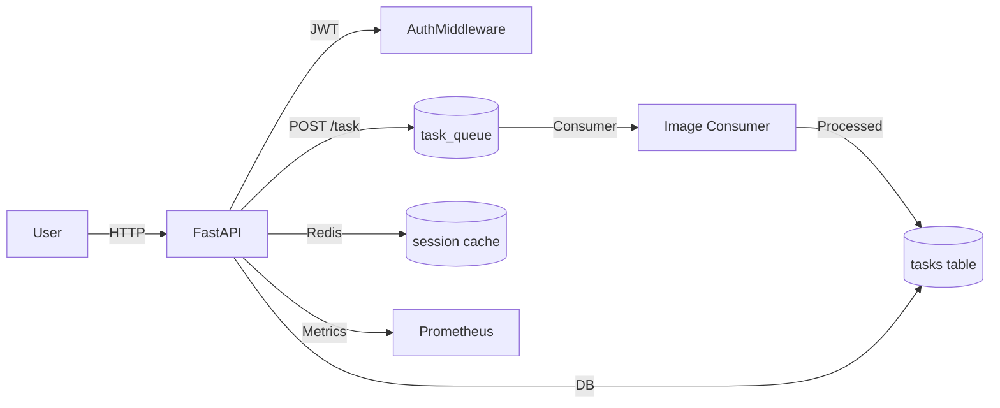

# image_service

### Асинхронный сервис для применения фильтров к изображениям  

  

---  

## Быстрый запуск  

1. Клонируйте репозиторий:  

    ```  
    git clone https://github.com/itsvovovova/image_service.git
    cd image_service
    ```  

2. Настройте окружение (скопируйте `.env.example` в `.env`):  

    ```dotenv  
    rabbitmq_host=rabbitmq  
    rabbitmq_port=5672  
    rabbitmq_management_port=15672  
    postgres_host=db  
    postgres_port=5432  
    prometheus_port=9090  
    grafana_port=3000  
    app_host=0.0.0.0  
    app_port=8007  
    jwt_secret_key=[secret_key]
    ```  

3. Запустите сервисы:  

    ``` 
    docker-compose up --build  
    ```  

4. Доступы после запуска:  
   - FastAPI: `http://localhost:8007`  
   - RabbitMQ: `http://localhost:15672`  
   - Prometheus: `http://localhost:9090`  
   - Grafana: `http://localhost:3000`  

---  

## 📊 Диаграмма  



---  

🔍 **Что умеет сервис?**  
1. Регистрация пользователей и JWT-аутентификация  
2. Асинхронная обработка изображений через RabbitMQ  
3. Применение фильтра к фотографии (было бы странно, если не умел бы)
4. Хранение данных в PostgreSQL + кеширование в Redis  
5. Мониторинг через Prometheus/Grafana  
6. Автоматическое тестирование (Pytest)


